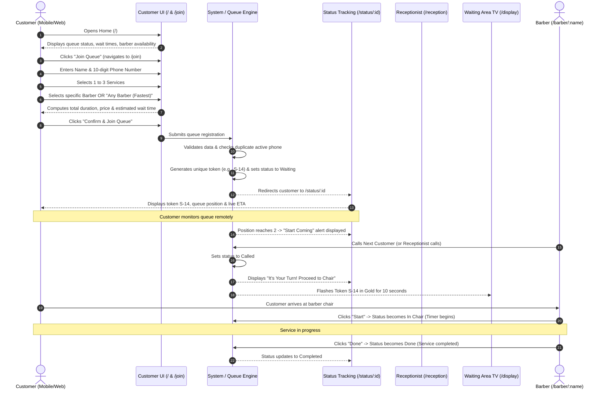
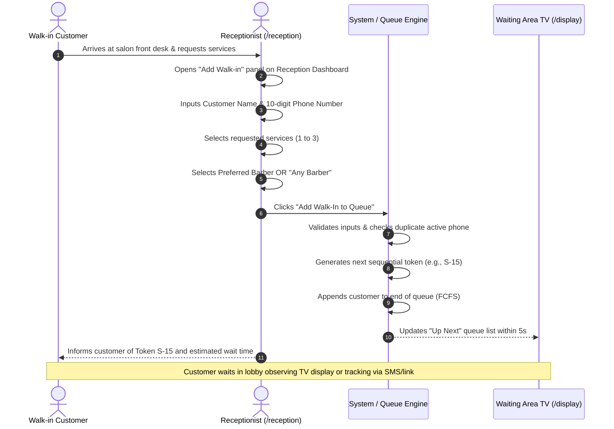
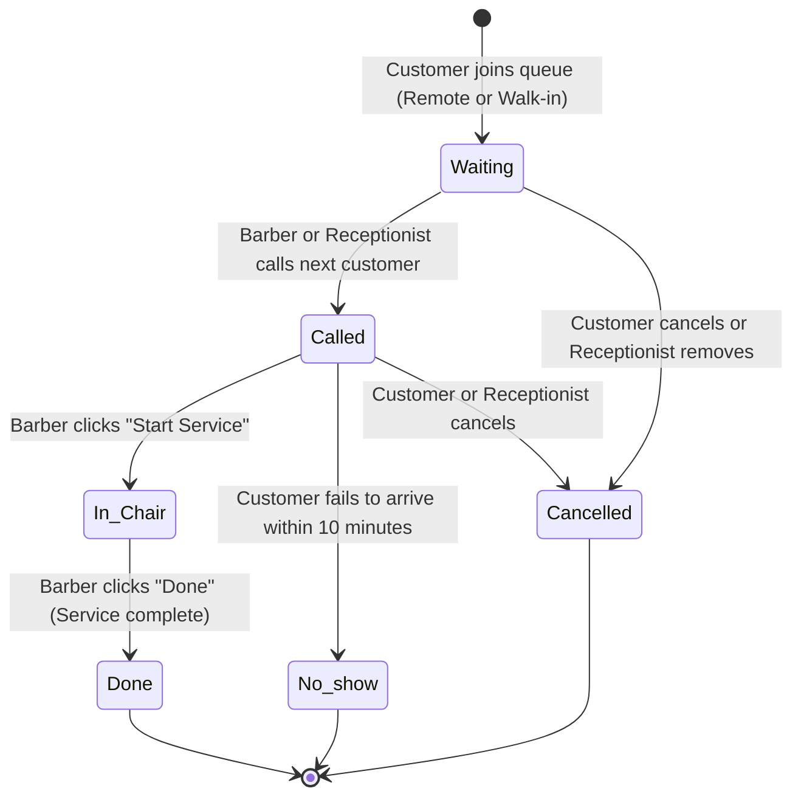
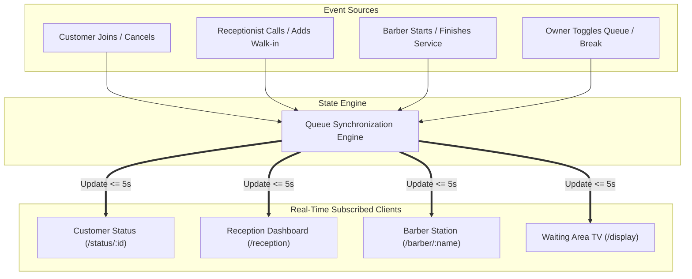

# Salon Queue Management System — Business Workflows & Queue Rules

This document specifies the end-to-end business workflows, operational rules, state transitions, wait-time calculations, synchronization protocols, and comprehensive test checklist for the **Salon Queue Management System**.

---

## Section 1: Remote Customer Flow

The remote customer journey allows clients to reserve their queue spot from anywhere via mobile or desktop web browser, eliminating lobby waiting time.

### Detailed Flow Steps

1. **Opens Home (`/`):** The customer visits the salon web app and reviews current salon metrics: open/closed status, current number of waiting customers, estimated wait time, and barber roster status (Available, Busy, or On Break). The customer can toggle the interface between English and Gujarati.
2. **Selects Join Queue:** Customer clicks the prominent **"Join Queue"** CTA button, routing to `/join`. (If the queue is closed, the button is disabled).
3. **Enters Contact Details:** Customer enters their full name and 10-digit mobile phone number.
4. **Selects Services:** Customer chooses 1, 2, or 3 salon services from the service catalog. Selecting more than 3 services is prevented by form validation.
5. **Selects Barber:** Customer selects a preferred barber or chooses **"Any Barber (Fastest)"**.
6. **Reviews Summary:** Customer reviews the live computed total duration (e.g., `45 mins`), total service price (e.g., `₹400`), and estimated wait time based on the selected barber's queue line.
7. **Confirms Spot:** Customer clicks **"Confirm & Join Queue"**.
8. **Token Generation:** The system validates the submission, verifies that no other active ticket exists for that phone number, issues the next sequential token (e.g., `S-14`), records the timestamp, and assigns the initial status of `Waiting`.
9. **Queue Tracking (`/status/:id`):** Customer is redirected to their unique tracking page showing their token, live queue position (e.g., `#3 in line`), assigned barber, and countdown ETA.
   - **Position 2 Notification ("Start Coming"):** When earlier customers finish and this customer advances to position #2, a prominent gold alert banner notifies them: *"Start Coming! You are next in line. Please head to the salon now."*
10. **Customer Called:** When the assigned barber's chair is ready, the receptionist or barber clicks **"Call Next"**. The ticket status transitions from `Waiting` to `Called`.
11. **Turn Notification ("It's Your Turn"):**
    - The customer's tracking screen displays an urgent banner: *"It's Your Turn! Please proceed to Chair [X]."*
    - Simultaneously, the customer's token flashes gold on the Waiting Area TV screen (`/display`) with an alert sound.
12. **Service Execution & Completion:**
    - The customer arrives at the chair. The barber clicks **"Start"**, transitioning the ticket status to `In Chair` and initiating the live service timer.
    - When styling finishes, the barber clicks **"Done"**, transitioning the ticket status to `Done`. The customer's tracking page updates to completed.

---

## Section 2: Walk-In Flow

For customers who arrive physically at the salon without registering online, the receptionist integrates them directly into the unified queue.

### Walk-In Rules & Integration

- **Single Unified Queue:** Walk-in customers enter the exact same queue as remote customers. There are no separate "online" vs. "offline" queues.
- **Fair Placement (FCFS):** The walk-in customer is always placed at the **tail end** of the active waiting queue based on their time of registration.
- **In-Salon Tracking:** The walk-in customer can track their progress directly on the Waiting Area TV (`/display`), or open the status URL on their phone if they provided a smartphone number.

---

## Section 3: Order / Queue Statuses & Lifecycle Transitions

The system utilizes exactly six (6) distinct queue statuses as defined in the project standard.

### Status Definitions

| Status | Name | Description | Active / Terminal |
| :--- | :--- | :--- | :--- |
| `Waiting` | **Waiting in Line** | Customer is registered and waiting for their turn in chronological order. | **Active** |
| `Called` | **Called to Chair** | Customer has been called by the receptionist or barber; 10-minute arrival grace window active. | **Active** |
| `In Chair` | **In Service** | Customer is seated in the styling chair; barber has started the service timer. | **Active** |
| `Done` | **Completed** | Barber has finished all requested services; customer vacates chair. | **Terminal** |
| `Cancelled` | **Cancelled** | Customer voluntarily withdrew or receptionist removed them prior to service. | **Terminal** |
| `No-show` | **Absent / No-Show** | Customer was called but failed to arrive at the chair within 10 minutes. | **Terminal** |

### Allowed vs. Forbidden Transitions

#### Allowed State Transitions:
1. `Waiting` $\rightarrow$ `Called`: Triggered when Barber or Receptionist clicks "Call Next".
2. `Waiting` $\rightarrow$ `Cancelled`: Triggered when Customer clicks "Cancel My Spot" or Receptionist cancels the ticket.
3. `Called` $\rightarrow$ `In Chair`: Triggered when Customer arrives at the chair and Barber clicks "Start".
4. `Called` $\rightarrow$ `No-show`: Triggered when Customer does not arrive within 10 minutes and Barber/Receptionist clicks "No-show".
5. `Called` $\rightarrow$ `Cancelled`: Triggered if Customer cancels or leaves before sitting down.
6. `In Chair` $\rightarrow$ `Done`: Triggered when Barber finishes the haircut/service and clicks "Done".

#### Strictly Forbidden Transitions:
- `Waiting` $\rightarrow$ `In Chair` *(Must be called first; cannot skip the Called notification state)*.
- `Waiting` $\rightarrow$ `Done` *(Cannot complete without being seated and served)*.
- `In Chair` $\rightarrow$ `No-show` *(A customer already seated in the chair cannot be marked absent)*.
- `In Chair` $\rightarrow$ `Waiting` *(Cannot demote an active service back into the waiting line)*.
- `Done` $\rightarrow$ Any State *(Terminal; record is archived in daily history)*.
- `No-show` $\rightarrow$ `Waiting` *(Terminal; a no-show customer cannot be un-cancelled back into their old spot. They must rejoin as a new entry)*.
- `Cancelled` $\rightarrow$ Any State *(Terminal; spot cannot be reactivated)*.

---

## Section 4: Queue Rules

The system strictly enforces the following eleven (11) core business rules:

1. **First-Come, First-Served (FCFS):** Queue ordering is strictly chronological based on the exact timestamp when the customer confirmed their registration (remotely or at the desk).
2. **"Call Next" Barber Dispatch Logic:** When a barber (or receptionist on their behalf) triggers "Call Next", the system scans the waiting queue from earliest to latest and selects the **first customer** who:
   - Explicitly selected that specific barber, **OR**
   - Selected **"Any Barber"**.
3. **Strict Barber Affinity:** A customer who selects a particular barber must **never** be assigned to or called by another barber. They remain in the queue until their chosen barber becomes available.
4. **One Customer Per Chair:** One barber can have only **one** customer in the `In Chair` status at any given time. A barber cannot start a new service until the current customer is marked `Done`.
5. **One Active Queue Spot Per Phone Number:** A phone number can only hold **one active queue spot** (`Waiting`, `Called`, or `In Chair`) across the entire salon. A customer must complete, cancel, or be marked no-show before registering again.
6. **Maximum 3 Services:** A customer can select a maximum of **3 services** per queue entry. Selection of a 4th service is blocked by the UI and rejected by the API.
7. **10-Minute No-Show Grace Period:** When a customer is moved to `Called`, an arrival timer starts. If the customer does not report to the chair within **10 minutes**, the receptionist or barber is permitted to click the **"No-show"** button, releasing the chair.
8. **Rejoining After No-Show:** If a customer marked `No-show` returns to the salon, they do not recover their previous position. They must join the queue again as a completely new entry, receive a brand-new token, and wait at the very end of the line.
9. **Online Cutoff 30 Minutes Before Closing:** Online remote queue joining (`/join`) automatically closes **30 minutes before salon closing time** (or immediately if the owner manually toggles the queue status to Closed).
10. **Walk-Ins Remain Permitted After Online Cutoff:** When online joining closes 30 minutes before closing, the front desk receptionist can still accept and register in-person walk-ins on `/reception` if chair capacity allows.
11. **Barber On Break Message:** If a customer attempts to select a barber who is currently marked "On Break", the system must display a clear, prominent warning:
    > ⚠️ *"Barber [Name] is currently on break. Selecting this barber may result in a significantly longer wait time."*

---

## Section 5: Waiting Time Calculation

### Core Formula

The system computes estimated waiting times using the standardized formula:

$$\text{Estimated Waiting Time (minutes)} = \frac{\text{Total Duration of Services Ahead}}{\text{Number of Barbers Working}}$$

### Component Definitions

1. **Total Duration of Services Ahead:**
   - The sum of service durations for all active customers ahead in the queue sequence.
   - Includes the remaining duration of customers currently in the chair (`In Chair`).
2. **Number of Barbers Working ($N$):**
   - Count of all on-duty barbers currently available or actively serving.
   - **Excludes** barbers who are toggled to **"On Break"** or **"Off Duty"**.
   - If $N = 0$, Estimated Wait Time displays: *"Indeterminate / Barbers Unavailable"*.

### Any Barber vs. Specific Barber Calculation

- **For "Any Barber" Customers:**
  $$\text{Wait Time} = \frac{\sum (\text{Durations of all waiting customers ahead eligible for any chair}) + \sum (\text{Remaining chair times})}{N_{\text{total active barbers}}}$$
- **For "Specific Barber" Customers:**
  $$\text{Wait Time} = \frac{\sum (\text{Durations of customers ahead waiting specifically for this barber or assigned to this chair}) + \text{Remaining time of customer in this chair}}{1}$$
  *(Since only this individual barber can service them, the effective divisor is 1).*

### Dynamic Recalculation Triggers

The waiting time is immediately recomputed across all tickets when any of the following lifecycle events occur:

1. **Customer Called / Service Started:** When a waiting customer transitions to `Called` or `In Chair`, their queued duration is deducted from the waiting pool, reducing the estimated wait time for all subsequent customers in line.
2. **Customer Cancelled:** When a customer cancels their spot, their total service duration is immediately removed from the sum of services ahead. All subsequent customers see their wait time decrease instantaneously.
3. **Customer Marked No-Show:** When a customer is marked `No-show`, their scheduled duration is eliminated from the pending calculation, immediately reducing wait times for following customers.
4. **Barber Toggles "On Break":** $N$ decreases by 1. The formula denominator shrinks, instantly recalculating and increasing the estimated wait times for all customers waiting in the general pool.
5. **Barber Returns from Break:** $N$ increases by 1. The formula denominator expands, lowering estimated wait times.

---

## Section 6: Real-Time Updates & Synchronization

### Synchronization Scope

To deliver a reliable, synchronized experience across the salon, the following four application views must reflect queue state changes in real time:

1. **Customer Status Screen (`/status/:id`)**
2. **Reception Dashboard (`/reception`)**
3. **Barber Chair View (`/barber/:name`)**
4. **Waiting Area TV Display (`/display`)**

### Performance & Latency Standard

- **Latency Guarantee:** Any status change initiated on one screen (e.g., Barber clicks "Start" or "Done", Receptionist clicks "Call Next", or Customer clicks "Cancel") must be reflected on all other connected screens **within 5 seconds**.
- **No Full-Page Reloads:** Screens must update reactively (via WebSocket events, Server-Sent Events, or short-interval background polling) without requiring the user or TV to manually refresh the browser.
- **TV Gold Flash Trigger:** When an event of type `CUSTOMER_CALLED` is broadcast, the Waiting Area TV (`/display`) immediately triggers a **10-second gold flashing animation (`#D4A017`)** on that customer's token box and sounds an alert chime.

---

## Section 7: Comprehensive Test Checklist

This checklist contains **16 rigorous test scenarios** verifying all workflows, validations, queue rules, and localization expectations.

| Test ID | Test Scenario | Preconditions | Test Steps | Expected Result | Pass/Fail |
| :--- | :--- | :--- | :--- | :--- | :--- |
| **TC-01** | **Normal Customer Joining** | Queue is Open. | 1. Open `/`. 2. Click "Join Queue". 3. Enter valid Name ("Aarav Patel") and 10-digit Phone ("9876543210"). 4. Select 1 service ("Haircut"). 5. Select "Any Barber". 6. Click "Confirm & Join Queue". | Token (e.g., `S-01`) is generated. User redirected to `/status/:id`. Status is `Waiting`. Queue position is `#1`. | Pending |
| **TC-02** | **Multiple Services Selection** | Service catalog active. | 1. Open `/join`. 2. Select 3 services (Haircut, Beard Trim, Hair Wash). 3. Verify summary calculation. 4. Attempt to select a 4th service. | Duration and price reflect sum of all 3 services. 4th checkbox is disabled; warning appears: *"Maximum 3 services allowed."* | Pending |
| **TC-03** | **Phone Number Validation** | On `/join` page. | 1. Enter name "Karan". 2. Test invalid phone entries: `"12345"`, `"abcdefghij"`, `"0987654321"`. 3. Attempt to submit. | Submission blocked. Red inline validation error: *"Please enter a valid 10-digit mobile number."* | Pending |
| **TC-04** | **Duplicate Phone Numbers** | Phone `"9876543210"` is already active in queue (`Waiting`). | 1. Open `/join` in another tab. 2. Enter name "Aarav P." and phone `"9876543210"`. 3. Select service and submit. | Submission rejected. Alert displayed: *"A queue spot is already active for this phone number."* No new token created. | Pending |
| **TC-05** | **Barber Preference Selection** | Barbers "Amit" and "Vikram" on duty. | 1. Customer A selects "Amit". 2. Customer B selects "Vikram". 3. Submit both entries. | Customer A is tied strictly to Amit's queue; Customer B is tied to Vikram's queue. Amit cannot see or call Customer B. | Pending |
| **TC-06** | **Any Barber Selection** | Customer in queue with "Any Barber". Amit finishes his client first. | 1. Customer C selects "Any Barber". 2. Barber Amit clicks "Call Next". | Customer C is assigned to Amit. Status changes to `Called`. Customer C's ticket reflects assigned barber "Amit". | Pending |
| **TC-07** | **Call Next Dispatch Order** | Queue order: T-1 (Amit), T-2 (Vikram), T-3 (Any). | 1. Barber Vikram clicks "Call Next". | Vikram calls T-2 (the earliest customer requesting Vikram). T-1 remains Waiting for Amit. Next time Vikram calls, he gets T-3. | Pending |
| **TC-08** | **Customer Notifications** | Customer at position #3 in line. | 1. Front customer finishes; position drops to #2. 2. Barber clicks "Call Next" for this customer. | At position #2, gold banner displays: *"Start Coming!"*. When called, screen flashes gold: *"It's Your Turn! Please proceed to Chair X."* | Pending |
| **TC-09** | **Start and Done Actions** | Customer called to chair. | 1. On `/barber/:name`, barber clicks "Start". 2. Verify timer starts. 3. Barber clicks "Done". | "Start" changes status to `In Chair`. Timer counts up/down. "Done" sets status to `Done`, clears chair, and cued for next client. | Pending |
| **TC-10** | **No-Show Handling** | Customer called 10 minutes ago and has not arrived. | 1. On `/reception`, locate customer with >10m elapsed since call. 2. Receptionist clicks "No-show". 3. Confirm modal. | Status transitions to `No-show`. Customer removed from active queue. Spot is vacated; ETA for following clients decreases. | Pending |
| **TC-11** | **Rejoining After No-Show** | Customer marked `No-show`. | 1. Same customer navigates to `/join` with same phone number. 2. Fills details and confirms. | Allowed because old spot is terminal. Customer receives a **brand-new token** and is appended to the **very end** of the queue. | Pending |
| **TC-12** | **Walk-In Registration** | Active queue has 3 customers. | 1. Receptionist opens "Add Walk-in" on `/reception`. 2. Enters walk-in details. 3. Clicks "Add Walk-In". | New token generated (e.g., S-04). Appended to end of queue as `#4`. Appears on Reception table and TV display within 5s. | Pending |
| **TC-13** | **Queue Closing Rules** | Salon closes at 9:00 PM. Clock reaches 8:30 PM. | 1. Check `/join` at 8:31 PM. 2. Check `/reception` walk-in form at 8:31 PM. | Online `/join` displays: *"Online Queue Closed"*; confirm button disabled. Receptionist can still add walk-ins at front desk. | Pending |
| **TC-14** | **Barber on Break Handling** | Barber "Vikram" toggles status to "On Break". | 1. Barber flips break switch on `/barber/vikram`. 2. Customer on `/join` inspects Vikram. | Vikram shown as "On Break" with warning: *"Selecting this barber may increase wait time."* Number of active working barbers decreases by 1. | Pending |
| **TC-15** | **Gujarati Language Support** | Any application screen. | 1. Click language toggle to `ગુજરાતી`. 2. Inspect titles, buttons, statuses, and error messages. | All UI text translates accurately to Gujarati. Numbers and tokens render legibly with proper Gujarati script typography. | Pending |
| **TC-16** | **Multiple Browser Windows Sync** | 4 browser windows open: Reception, Barber, Customer, TV. | 1. Barber clicks "Call Next". 2. Observe all 4 screens simultaneously without manual refresh. | All 4 screens update within **5 seconds**: TV flashes token in gold, Customer sees "It's Your Turn", Reception table updates status. | Pending |

---
